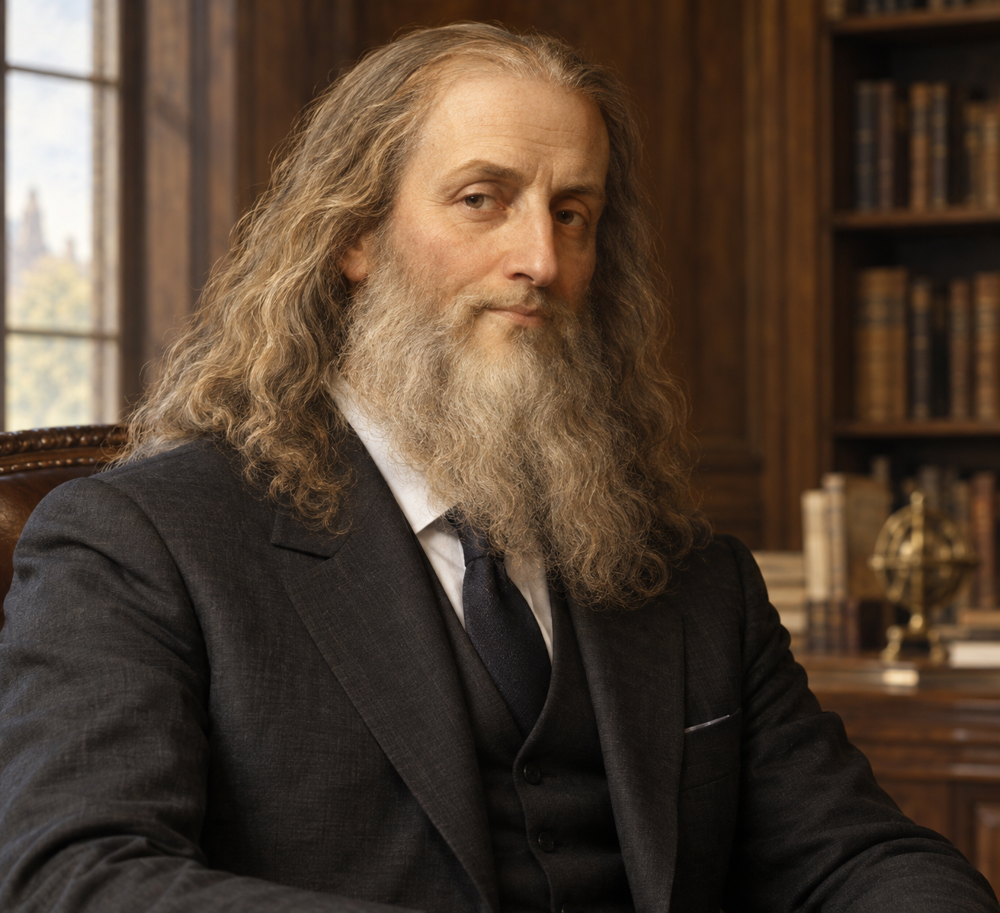

# PR2DAVINCI
Adobe Premiere to DaVinci Resolve Project Converter

<p align="center">
  
</p>

Первая версия — **1.0.0**. История изменений: [`CHANGELOG.md`](CHANGELOG.md).

Кроссплатформенный desktop-конвертер Adobe Premiere Pro в DaVinci Resolve.
Приложение читает обычные и gzip-сжатые `.prproj`, переносит выбранную секвенцию
в DaVinci Resolve Studio и автоматически экспортирует проект в `.drp`.

## Запуск

Нужен Python 3.10 или новее.

```bash
python -m venv .venv
source .venv/bin/activate
python -m pip install .
premiere-to-resolve
```

На Windows активируйте окружение командой `.venv\\Scripts\\activate`.
При первом запуске окно можно переключить между русским и английским.

## Конвертация

Перетащите `.prproj` в окно или выберите его кнопкой. Укажите секвенцию,
папку и имя файла. «Передать проект в Resolve Studio» автоматически создаёт
DRP, а «Сохранить XML» экспортирует interchange-файл для ручного импорта:
FCPXML для нативных `.prproj` и FCP 7 XML для XML-представления Premiere.
Список содержит только секвенции проекта (без вложенных ссылок), поддерживает
поиск по имени и различает одноимённые секвенции по их ID.
Если Resolve не найден автоматически, укажите исполняемый файл Resolve Studio.

Для локальной передачи нужна DaVinci Resolve Studio с включённым внешним
scripting (**Preferences → System → General → External scripting using → Local**).
Если Resolve не запущен, PR2DAVINCI запустит его. Перед передачей закройте
открытый в Resolve проект; если в нём есть изменения, сначала сохраните их.
Импортированный таймлайн сохраняется в DRP автоматически; временный проект
удаляется из базы Resolve.

Нативные `.prproj` разбираются библиотекой py-premiere и экспортируются в
FCPXML 1.9 — формат, который Resolve импортирует напрямую. Клиповые точки,
дорожки, тайминг и доступные ссылки на медиа переносятся; если Windows-пути
можно сопоставить с подключённым диском проекта, приложение делает это
автоматически. Несопоставленные файлы потребуют relink в Resolve, а в журнале
будут отмечены пропущенные синтетические клипы и неподдержанные эффекты,
переходы или изменение скорости. Вложенные и multicam-секвенции,
Essential Graphics и Lumetri могут требовать ручной проверки.

Разбор Premiere использует стороннюю библиотеку [py-premiere](https://github.com/Pouf/py-premiere)
(MIT License); её лицензия распространяется вместе с установленным пакетом.

Исходный код и материалы PR2DAVINCI посвящены общественному достоянию по
CC0 1.0 Universal; см. [`LICENSE`](LICENSE). Лицензии сторонних компонентов
и ограничения на права третьих лиц остаются в силе.

## Сборка desktop-приложения

Готовые сборки для Windows и macOS прикрепляются к [релизу PR2DAVINCI v1.0.0](https://github.com/ghostofspirit/pr2davinci/releases/tag/v1.0.0):

- [Windows x86_64 — portable ZIP](https://github.com/ghostofspirit/pr2davinci/releases/download/v1.0.0/PR2DAVINCI-1.0.0-windows-x86_64.zip)
- [macOS Apple Silicon — ARM64 ZIP](https://github.com/ghostofspirit/pr2davinci/releases/download/v1.0.0/PR2DAVINCI-1.0.0-macos-arm64.zip)
- [macOS Intel — x86_64 ZIP](https://github.com/ghostofspirit/pr2davinci/releases/download/v1.0.0/PR2DAVINCI-1.0.0-macos-x86_64.zip)

В Windows распакуйте архив и запустите `PR2DAVINCI/PR2DAVINCI.exe`. На macOS распакуйте
архив и переместите `PR2DAVINCI.app` в «Программы». Эти сборки включают Python и
зависимости — отдельно устанавливать Python не нужно. Resolve Studio в комплект
не входит.

Сборки публикуются workflow [`Build desktop release`](.github/workflows/release-desktop.yml)
на нативных Windows, Intel Mac и Apple Silicon runners. Они проверяются unit-
тестами и собираются из неизменённого тега `v1.0.0`. После распаковки Windows
может показать предупреждение SmartScreen, а macOS — предупреждение Gatekeeper:
приложения пока не подписаны сертификатом разработчика и не нотариализованы.
Это не ошибка архива; для массовой установки без таких предупреждений понадобятся
сертификат Windows code signing и Apple Developer ID/notarization.

Чтобы собрать приложение самостоятельно, установите проект и PyInstaller на
целевой ОС; сборка должна выполняться на соответствующей платформе.

```bash
python -m pip install . pyinstaller pillow
pyinstaller --noconfirm --clean --windowed --onedir \
  --name PR2DAVINCI \
  --collect-all premiere_to_resolve \
  --collect-all py_premiere \
  launch_gui.py
```

### Flatpak для Linux

Готовый пакет для Linux x86_64 можно скачать со страницы [релиза PR2DAVINCI v1.0.0](https://github.com/ghostofspirit/pr2davinci/releases/tag/v1.0.0):
[PR2DAVINCI-1.0.0-x86_64.flatpak](https://github.com/ghostofspirit/pr2davinci/releases/download/v1.0.0/PR2DAVINCI-1.0.0-x86_64.flatpak).

Установка и запуск скачанного пакета:

```sh
flatpak install --user ./PR2DAVINCI-1.0.0-x86_64.flatpak
flatpak run --user com.serotoninja.PremiereToResolve
```

Пакету нужен KDE runtime 6.11 из Flathub. Если Flatpak предложит установить его,
подтвердите установку.

Манифест Flatpak и команды сборки находятся в [`flatpak/README.md`](flatpak/README.md).
Для запуска конвертера в Flatpak ему разрешён доступ к домашней папке, чтобы
открывать проекты Premiere и сохранять DRP-файлы. Для связи с Resolve Flatpak
использует `flatpak-spawn --host` и запускает ResolvePython на хосте.

## CLI

GUI — основной способ запуска. Для командной строки установите проект и
используйте отдельную команду, чтобы отдельно создать XML:

```bash
premiere-to-resolve-cli input.prproj --list-sequences
premiere-to-resolve-cli input.prproj -o timeline.fcpxml --sequence "Edit v3"
```

