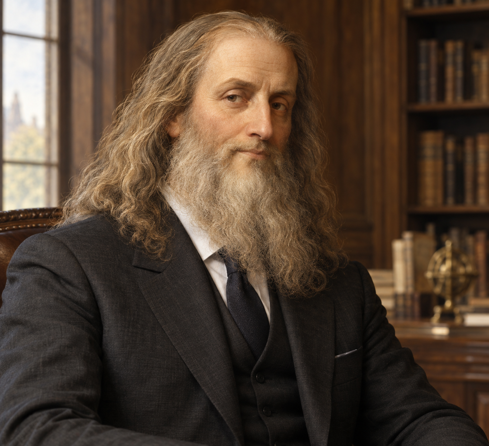

# PR2DAVINCI

**Adobe Premiere Pro → DaVinci Resolve — V2.0.0**

<p align="center">
  
</p>

**[English](#english) | [Русский](#русский)**

## English

V2 converts a native Premiere `.prproj` project into a DaVinci Resolve `.drp`
file. It writes the DRP directly, so Resolve does not need to be installed or
running during conversion. The same exporter is available in the desktop GUI
and command line.

V2.0.0 is the stable release. The source is on the
[`v2/direct-drp` branch](https://github.com/ghostofspirit/pr2davinci/tree/v2/direct-drp).
Linux downloads:

- [Flatpak for x86_64](https://github.com/ghostofspirit/pr2davinci/releases/download/v2.0.0/PR2DAVINCI-v2.0.0-linux-x86_64.flatpak)
- [RPM for Fedora 44](https://github.com/ghostofspirit/pr2davinci/releases/download/v2.0.0/premiere-to-resolve-2.0.0-1.fc44.noarch.rpm)

### What V2 does

- Includes the project's timelines, media pool bins, and media references in
  the DRP.
- Leaves source media offline when it is not available, so it can be relinked
  in Resolve later.
- Offers the same DRP export through the GUI and the `premiere-to-resolve-drp`
  command.
- Does not launch Resolve or modify a project already open there.

The generated archive has been compared offline with a Relink-created DRP and
opened successfully in Resolve on a real project. Effects, transitions,
retiming, multicam, Essential Graphics, and Lumetri may still need review or
reconstruction.

### Run V2 from source

Python 3.10 or newer is required.

```bash
python -m venv .venv
source .venv/bin/activate
python -m pip install .
premiere-to-resolve
```

On Windows, activate the environment with `.venv\\Scripts\\activate`.

To create a DRP from the whole Premiere project:

```bash
premiere-to-resolve-drp input.prproj -o output.drp
```

The command saves all project timelines and bins without launching Resolve. If
the output name already exists, it chooses the next available name, such as
`output (2).drp`. The older `premiere-to-resolve-cli` command remains available
for FCP 7 XML interchange.

### Linux Flatpak

Install the downloaded bundle (it includes the GUI and direct DRP CLI). Flatpak
may offer to install its KDE runtime from Flathub:

```bash
flatpak install --user ./PR2DAVINCI-v2.0.0-linux-x86_64.flatpak
```

Launch the GUI with `flatpak run --user com.serotoninja.PremiereToResolve`.
To export a project from the command line:

```bash
flatpak run --user --command=premiere-to-resolve-drp \
  com.serotoninja.PremiereToResolve \
  "$HOME/path/to/input.prproj" -o "$HOME/path/to/output.drp"
```

### Fedora RPM

Download the RPM for Fedora 44 and install it with DNF:

```bash
sudo dnf install ./premiere-to-resolve-2.0.0-1.fc44.noarch.rpm
```

The package includes the GUI and DRP CLI. DEB packages are not available yet.

### License

PR2DAVINCI source and materials are dedicated to the public domain under
[CC0 1.0 Universal](LICENSE). Third-party components retain their own licenses;
see [`THIRD_PARTY_NOTICES.md`](THIRD_PARTY_NOTICES.md).

---

## Русский

V2 преобразует нативный проект Premiere `.prproj` в проект DaVinci Resolve
`.drp`. DRP создаётся напрямую: устанавливать или запускать Resolve во время
конвертации не нужно. Один и тот же экспорт доступен в графическом интерфейсе и
командной строке.

V2.0.0 — стабильный релиз. Исходный код — в ветке
[`v2/direct-drp`](https://github.com/ghostofspirit/pr2davinci/tree/v2/direct-drp).
Сборки для Linux:

- [Flatpak для x86_64](https://github.com/ghostofspirit/pr2davinci/releases/download/v2.0.0/PR2DAVINCI-v2.0.0-linux-x86_64.flatpak)
- [RPM для Fedora 44](https://github.com/ghostofspirit/pr2davinci/releases/download/v2.0.0/premiere-to-resolve-2.0.0-1.fc44.noarch.rpm)

### Что умеет V2

- Переносит в DRP секвенции, папки Media Pool и ссылки на медиа проекта.
- Если исходники недоступны, они остаются Offline — монтажёр может сделать
  relink в Resolve.
- Создаёт DRP одинаковым экспортом из GUI и командой
  `premiere-to-resolve-drp`.
- Не запускает Resolve и не меняет открытый в нём проект.

Структура архива офлайн сравнивалась с DRP, созданным Relink; готовый проект
открыт и проверен в Resolve на реальном материале. Эффекты, переходы,
изменение скорости, multicam, Essential Graphics и Lumetri всё ещё могут
потребовать проверки или ручного восстановления.

### Запуск V2 из исходников

Нужен Python 3.10 или новее.

```bash
python -m venv .venv
source .venv/bin/activate
python -m pip install .
premiere-to-resolve
```

В Windows активируйте окружение командой `.venv\\Scripts\\activate`.

Чтобы сохранить весь проект Premiere в DRP:

```bash
premiere-to-resolve-drp input.prproj -o output.drp
```

Команда включает все секвенции и папки проекта и не запускает Resolve. Если
указанное имя файла уже занято, будет выбрано следующее свободное, например
`output (2).drp`. Для обмена через FCP 7 XML остаётся команда
`premiere-to-resolve-cli`.

### Linux Flatpak

Установите скачанный bundle. В него входят GUI и прямая CLI-команда экспорта DRP:

```bash
flatpak install --user ./PR2DAVINCI-v2.0.0-linux-x86_64.flatpak
```

Запустить GUI можно командой `flatpak run --user com.serotoninja.PremiereToResolve`.
Чтобы создать DRP из командной строки:

```bash
flatpak run --user --command=premiere-to-resolve-drp \
  com.serotoninja.PremiereToResolve \
  "$HOME/path/to/input.prproj" -o "$HOME/path/to/output.drp"
```

### Fedora RPM

Скачайте RPM для Fedora 44 и установите его через DNF:

```bash
sudo dnf install ./premiere-to-resolve-2.0.0-1.fc44.noarch.rpm
```

В пакет входят GUI и CLI для DRP. Пакет DEB пока недоступен.

### Лицензия

Исходный код и материалы PR2DAVINCI посвящены общественному достоянию по
[лицензии CC0 1.0 Universal](LICENSE). У сторонних компонентов свои лицензии;
см. [`THIRD_PARTY_NOTICES.md`](THIRD_PARTY_NOTICES.md).
